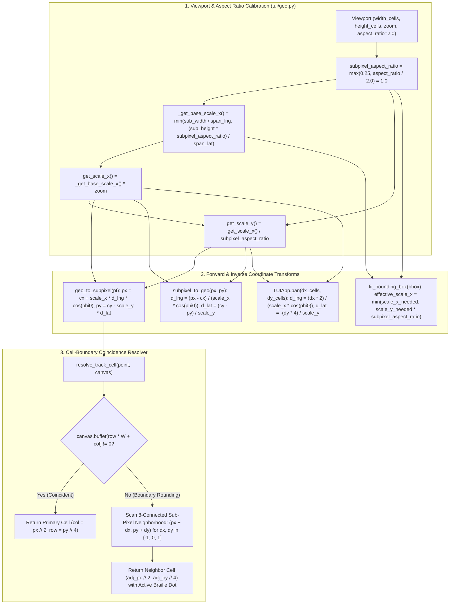

# Implementation Plan — Step 2: Calibrate Conformal Sub-Pixel Aspect Ratio (`tui/geo.py` & `tui/app.py`)

> **Parent Plan:** [Implementation Plan — TUI Live Train Telemetry and Vector Track Misalignment During Viewport Zoom](./tui-train-track-misalignment-zoom-fix-plan.md#step-2-calibrate-conformal-sub-pixel-aspect-ratio-in-tuigeopy-and-tuiapppy)  
> **Sibling Sub-Plans:** [Step 1: High-Density Topology Enrichment (`tracks.json` & `stations.json`)](./tui-step-1-enrich-tracks-and-stations-plan.md)  
> **Issue Reference:** [Issue: Live Train Telemetry and Vector Track Misalignment During Viewport Zoom](./tui-train-track-misalignment-zoom-issue.md)  
> **Target Files:** [`../tui/geo.py`](../tui/geo.py), [`../tui/app.py`](../tui/app.py)  
> **Test Suites:** [`../tests/test_tui_geo.py`](../tests/test_tui_geo.py), [`../tests/test_tui_controls.py`](../tests/test_tui_controls.py)  
> **Relevant Rules & Skills:** [`../.agents/rules/architecture.md`](../.agents/rules/architecture.md), [`../.agents/rules/terminal-and-rendering-compatibility.md`](../.agents/rules/terminal-and-rendering-compatibility.md), [`../.agents/rules/diagrams-and-visual-documentation.md`](../.agents/rules/diagrams-and-visual-documentation.md), [`../.agents/rules/markdown-relative-paths.md`](../.agents/rules/markdown-relative-paths.md)

---

## 1. Objective & Engineering Scope

Step 2 eliminates the **50% vertical latitude compression** and **character-cell boundary quantization phase error** in the geospatial projection engine ([`../tui/geo.py`](../tui/geo.py)) and camera pan kinematics ([`../tui/app.py`](../tui/app.py)).

### 1.1 Key Design Goals
1. **Conformal Sub-Pixel Aspect Ratio Calibration (`GeoProjector.subpixel_aspect_ratio`):**
   - Terminal character cells have a physical height-to-width ratio of $A_{\text{cell}} = H_{\text{cell}} / W_{\text{cell}} \approx 2.0$.
   - Because [`BrailleCanvas`](../tui/geo.py#L333-L364) subdivides each character cell into $2$ horizontal sub-pixels and $4$ vertical sub-pixels ($4 / 2 = 2.0$), the $2 \times 4$ sub-pixel lattice **already compensates for the $2:1$ character cell aspect ratio**, making each individual Braille dot physically square ($A_{\text{sub}} = A_{\text{cell}} / 2.0 = 1.0$).
   - Replace the double-compensated vertical divisor (`scale_y = scale_x / self.viewport.aspect_ratio`) with `scale_y = scale_x / self.subpixel_aspect_ratio` where `subpixel_aspect_ratio = max(0.25, self.viewport.aspect_ratio / 2.0)`.
2. **Dual-Axis National Bounding Box Fit at Base Zoom (`GeoProjector._get_base_scale_x`):**
   - At `zoom = 1.0`, compute the base horizontal scale as the minimum of the horizontal span fit and aspect-adjusted vertical span fit across `GREECE_PRESET` (`min_lat=37.50, max_lat=41.35, min_lng=21.45, max_lng=26.65`), ensuring the entire Greek railway network fits within both `sub_width` and `sub_height` without clipping northern Thrace or southern Attica on compact $80 \times 24$ terminals.
3. **Sub-Pixel Cell-Boundary Coincidence Resolver (`GeoProjector.resolve_track_cell`):**
   - Add `resolve_track_cell(point: GeoPoint, canvas: Optional[BrailleCanvas] = None) -> Tuple[int, int]` to resolve $\pm 1$ sub-pixel rounding discrepancies at character cell boundaries (`px = 2k - 1` vs. `2k`, `py = 4m - 1` vs. `4m`), guaranteeing that any coordinate snapped to a track polyline lands on a character cell containing an active Braille dot mask (`canvas.buffer[idx] != 0`).
4. **Exact 1:1 Cell-to-Degree Camera Panning (`TUIApp.pan`):**
   - Refactor [`TUIApp.pan(dx_cells, dy_cells)`](../tui/app.py#L215-L240) to derive longitudinal and latitudinal degree shifts directly from `self.projector.get_scale_x()` and `self.projector.get_scale_y()`, ensuring a camera pan of `(dx_cells, dy_cells)` shifts projected map features by exactly `(dx_cells, dy_cells)` character cells at every zoom level and terminal dimension.

---

## 2. Mathematical Derivation & Geometric Proof

### 2.1 Why Dividing `scale_y` by `viewport.aspect_ratio` (`2.0`) Causes 50% Vertical Compression

Let a terminal character cell have physical width $W_{\text{cell}}$ (mm) and physical height $H_{\text{cell}}$ (mm), with character cell aspect ratio:

$$A_{\text{cell}} = \frac{H_{\text{cell}}}{W_{\text{cell}}} \approx 2.0$$

Each character cell in [`BrailleCanvas`](../tui/geo.py#L333) is a $2 \times 4$ matrix of sub-pixel dots ($2$ columns wide by $4$ rows tall). Therefore, the physical dimensions of a single sub-pixel dot are:

$$W_{\text{sub}} = \frac{W_{\text{cell}}}{2}, \qquad H_{\text{sub}} = \frac{H_{\text{cell}}}{4}$$

The physical height-to-width ratio of a single sub-pixel dot ($A_{\text{sub}}$) is:

$$A_{\text{sub}} = \frac{H_{\text{sub}}}{W_{\text{sub}}} = \frac{H_{\text{cell}} / 4}{W_{\text{cell}} / 2} = \frac{2}{4} \cdot \frac{H_{\text{cell}}}{W_{\text{cell}}} = \frac{A_{\text{cell}}}{2.0}$$

For a standard $2:1$ terminal font ($A_{\text{cell}} = 2.0$), each sub-pixel dot has:

$$A_{\text{sub}} = \frac{2.0}{2.0} = 1.0 \quad \text{(physically square on screen)}$$

To achieve a **conformal** (angle-preserving, isotropic) Equirectangular projection at standard parallel $\phi_0 = 39.5^\circ\text{N}$, an infinitesimal north-south displacement $dy_{\text{phys}}$ (in physical mm per meter on Earth) must equal an east-west displacement $dx_{\text{phys}}$ (in physical mm per meter on Earth):

$$\underbrace{\left(\text{scale}_x \cdot \cos\phi_0\right)}_{\Delta px / \Delta\lambda} \cdot W_{\text{sub}} = \underbrace{\text{scale}_y}_{\Delta py / \Delta\phi} \cdot \cos\phi_0 \cdot H_{\text{sub}} \implies \frac{\text{scale}_x}{\text{scale}_y} = \frac{H_{\text{sub}}}{W_{\text{sub}}} = A_{\text{sub}} = \frac{A_{\text{cell}}}{2.0}$$

Therefore, the conformal vertical sub-pixel scale is:

$$\text{scale}_y = \frac{\text{scale}_x}{A_{\text{sub}}} = \frac{\text{scale}_x}{A_{\text{cell}} / 2.0}$$

| Projection Quantity | Legacy Formula (Buggy) | Calibrated Conformal Formula | Value at $A_{\text{cell}} = 2.0$ |
| :--- | :---: | :---: | :---: |
| **Sub-Pixel Aspect Ratio ($A_{\text{sub}}$)** | $A_{\text{cell}} = 2.0$ | $A_{\text{cell}} / 2.0$ | $1.0$ |
| **Vertical Sub-Pixel Scale ($\text{scale}_y$)** | $\text{scale}_x / 2.0$ | $\text{scale}_x / A_{\text{sub}}$ | $\text{scale}_x$ |
| **Sub-Pixel Displacement Ratio ($\Delta px / \Delta py$ for $\Delta\lambda = \Delta\phi$)** | $2.0 \cdot \cos(39.5^\circ) \approx 1.543$ | $1.0 \cdot \cos(39.5^\circ) \approx 0.772$ | $0.7716$ |
| **Character Cell Displacement Ratio ($\Delta \text{col} / \Delta \text{row}$ for $\Delta\lambda = \Delta\phi$)** | $4.0 \cdot \cos(39.5^\circ) \approx 3.086$ (assumes 4:1 tall font!) | $2.0 \cdot \cos(39.5^\circ) \approx 1.543$ (true 2:1 tall font) | $1.5432$ |

---

### 2.2 Visual Architecture (ASCII & Mermaid)

#### ASCII Diagram: Sub-Pixel Lattice Geometry & Cell-Boundary Tie-Breaking

```text
+---------------------------------------------------------------------------------------------------+
| 1. CONFORMAL 2x4 BRAILLE SUB-PIXEL LATTICE vs. LEGACY DOUBLE ASPECT-RATIO SQUASH                  |
+---------------------------------------------------------------------------------------------------+

  Physical Terminal Cell (W_cell x H_cell, Aspect Ratio A_cell = H_cell / W_cell = 2.0):
  +---------+---------+   ---
  | (0,0)   | (1,0)   |    ^
  |  dot 1  |  dot 4  |    |  H_sub = H_cell / 4 = 0.5 * W_cell
  +---------+---------+    v
  | (0,1)   | (1,1)   |   ---
  |  dot 2  |  dot 5  |       Because W_sub = W_cell / 2 = 0.5 * W_cell,
  +---------+---------+       every sub-pixel dot is ALREADY physically square:
  | (0,2)   | (1,2)   |       A_sub = H_sub / W_sub = (A_cell / 2.0) = 1.0!
  |  dot 3  |  dot 6  |
  +---------+---------+       Conformal Scale:
  | (0,3)   | (1,3)   |       scale_y = scale_x / A_sub = scale_x (when A_cell = 2.0)
  |  dot 7  |  dot 8  |
  +---------+---------+
  |<------->|
   W_sub = W_cell / 2

+---------------------------------------------------------------------------------------------------+
| 2. SUB-PIXEL CELL-BOUNDARY COINCIDENCE RESOLVER: GeoProjector.resolve_track_cell()                |
+---------------------------------------------------------------------------------------------------+

       Cell (col=9, row=5)                 Cell (col=10, row=5)
  +-------------+-------------+       +-------------+-------------+
  | px=18,py=20 | px=19,py=20 |       | px=20,py=20 | px=21,py=20 |
  |      .      |      .      |       |   [TRACK]   |      .      |
  +-------------+-------------+       +------+------+-------------+
  | px=18,py=21 | px=19,py=21 |       | px=20|py=21 | px=21,py=21 |
  |      .      |  (Train P)  | ----> |   [TRACK]   |      .      |
  |             |  rounds to  | snaps |   dot set   |             |
  |             |   px = 19   |  +1px |  (col = 10) |             |
  +-------------+-------------+       +-------------+-------------+
  |   buffer[5*W + 9] == 0    |       |   buffer[5*W + 10] != 0   |
  |   (Empty cell: no track)  |       |   (Active Braille track)  |
  +---------------------------+       +---------------------------+
```

#### Mermaid Flowchart: Conformal Projection & Cell Resolution Pipeline



---

## 3. Detailed Code Specifications

### 3.1 Modifications to `GeoProjector` in [`../tui/geo.py`](../tui/geo.py)

Update [`GeoProjector`](../tui/geo.py#L204-L331) with the following properties and methods:

#### A. `subpixel_aspect_ratio`, `_get_base_scale_x()`, `get_scale_x()`, and `get_scale_y()`
```python
    @property
    def subpixel_aspect_ratio(self) -> float:
        """Physical height-to-width ratio of a single 2x4 Braille sub-pixel dot.

        Because each terminal character cell is subdivided into 2 horizontal
        sub-pixels and 4 vertical sub-pixels, the 2:4 sub-pixel grid already
        divides the character cell aspect ratio (H_cell / W_cell, typically ~2.0)
        by 2.0, yielding a square 1.0 sub-pixel aspect ratio for a 2:1 font.
        """
        return max(0.25, self.viewport.aspect_ratio / 2.0)

    def _get_base_scale_x(self) -> float:
        """Compute base horizontal scale (sub-pixels / deg lng) fitting GREECE_PRESET at zoom=1.0."""
        scale_x_w = self.sub_width / GREECE_PRESET.span_lng
        scale_x_h = (self.sub_height * self.subpixel_aspect_ratio) / GREECE_PRESET.span_lat
        return min(scale_x_w, scale_x_h)

    def get_scale_x(self) -> float:
        """Calculate the horizontal scale in sub-pixels per degree of longitude.

        Base scale fits the Greek national bounding box across both canvas width
        and canvas height at zoom=1.0.

        Returns:
            Scale factor in sub-pixels per degree longitude.
        """
        return self._get_base_scale_x() * self.viewport.zoom

    def get_scale_y(self) -> float:
        """Calculate the vertical scale in sub-pixels per degree of latitude.

        Returns:
            Scale factor in sub-pixels per degree latitude.
        """
        return self.get_scale_x() / self.subpixel_aspect_ratio
```

#### B. `geo_to_subpixel()` and `subpixel_to_geo()`
Update [`geo_to_subpixel()`](../tui/geo.py#L249-L270) and [`subpixel_to_geo()`](../tui/geo.py#L283-L305) to use `self.get_scale_y()` instead of `scale_x / self.viewport.aspect_ratio`:

```python
    def geo_to_subpixel(self, point: GeoPoint) -> Tuple[int, int]:
        """Convert a WGS84 coordinate into sub-pixel canvas coordinates (px, py).

        Args:
            point: Geographic point (lat, lng).

        Returns:
            Tuple of integer sub-pixel coordinates (px, py).
        """
        center_x = self.sub_width / 2.0
        center_y = self.sub_height / 2.0
        scale_x = self.get_scale_x()
        scale_y = self.get_scale_y()

        delta_lng = point.lng - self.viewport.center.lng
        delta_lat = point.lat - self.viewport.center.lat

        px = center_x + scale_x * delta_lng * self._cos_phi0
        py = center_y - scale_y * delta_lat

        return int(round(px)), int(round(py))
```

```python
    def subpixel_to_geo(self, px: int, py: int) -> GeoPoint:
        """Convert sub-pixel coordinates (px, py) back to WGS84 coordinates.

        Args:
            px: Sub-pixel X coordinate.
            py: Sub-pixel Y coordinate.

        Returns:
            Corresponding GeoPoint (lat, lng).
        """
        center_x = self.sub_width / 2.0
        center_y = self.sub_height / 2.0
        scale_x = self.get_scale_x()
        scale_y = self.get_scale_y()

        delta_lng = (px - center_x) / (scale_x * self._cos_phi0)
        delta_lat = (center_y - py) / scale_y

        lng = self.viewport.center.lng + delta_lng
        lat = self.viewport.center.lat + delta_lat

        return GeoPoint(lat=lat, lng=lng)
```

#### C. `resolve_track_cell()`
Add `resolve_track_cell()` directly after `geo_to_cell()` in [`../tui/geo.py`](../tui/geo.py#L271-L282):

```python
    def resolve_track_cell(
        self,
        point: GeoPoint,
        canvas: Optional["BrailleCanvas"] = None,
    ) -> Tuple[int, int]:
        """Convert a WGS84 coordinate to character cell (col, row) with sub-pixel track tie-breaking.

        When a point lies on a track polyline, floating-point rounding in geo_to_subpixel()
        can occasionally place (px, py) 1 sub-pixel across a character cell boundary from the
        integer Bresenham line rasterized on BrailleCanvas. If canvas is provided and the
        primary cell (px // 2, py // 4) has no active Braille dots, this method inspects the
        immediate 1-sub-pixel neighborhood and snaps to the adjacent cell containing the
        rasterized track dot.

        Args:
            point: Geographic point (lat, lng).
            canvas: Optional rasterized BrailleCanvas containing track bitmasks.

        Returns:
            Tuple of integer character cell coordinates (col, row).
        """
        px, py = self.geo_to_subpixel(point)
        col = px // 2
        row = py // 4

        if canvas is None:
            return col, row

        w_cells = canvas.width_cells
        h_cells = canvas.height_cells

        if 0 <= col < w_cells and 0 <= row < h_cells:
            if canvas.buffer[row * w_cells + col] != 0:
                return col, row

        # Check immediate 1-sub-pixel neighborhood (cardinal offsets first, then diagonals)
        neighbors = (
            (0, -1),
            (0, 1),
            (-1, 0),
            (1, 0),
            (-1, -1),
            (1, -1),
            (-1, 1),
            (1, 1),
        )
        for dx, dy in neighbors:
            adj_px = px + dx
            adj_py = py + dy
            if 0 <= adj_px < canvas.sub_width and 0 <= adj_py < canvas.sub_height:
                adj_col = adj_px // 2
                adj_row = adj_py // 4
                if canvas.buffer[adj_row * w_cells + adj_col] != 0:
                    return adj_col, adj_row

        return col, row
```

#### D. `fit_bounding_box()`
Update [`fit_bounding_box()`](../tui/geo.py#L318-L331) to use `self.subpixel_aspect_ratio` and `self._get_base_scale_x()`:

```python
    def fit_bounding_box(self, bbox: BoundingBox) -> None:
        """Adjust viewport center and zoom to fit a bounding box within the canvas.

        Args:
            bbox: Geographic bounding box to frame in the viewport.
        """
        self.viewport.center = bbox.center
        scale_x_needed = self.sub_width / (bbox.span_lng * self._cos_phi0)
        scale_y_needed = self.sub_height / bbox.span_lat
        effective_scale_x = min(scale_x_needed, scale_y_needed * self.subpixel_aspect_ratio)

        base_scale = self._get_base_scale_x()
        self.viewport.zoom = max(0.2, effective_scale_x / base_scale)
```

---

### 3.2 Modifications to `TUIApp.pan` in [`../tui/app.py`](../tui/app.py)

Update [`TUIApp.pan()`](../tui/app.py#L215-L240) so horizontal and vertical cell offsets translate into exact degree displacements via `self.projector.get_scale_x()` and `self.projector.get_scale_y()`:

```python
    def pan(self, dx_cells: int, dy_cells: int) -> None:
        """Pan viewport by character cell offsets with conformal scale compensation.

        Translates discrete terminal cell displacement (2 horizontal sub-pixels per
        column, 4 vertical sub-pixels per row) into continuous WGS84 degree shifts
        using the projector's active conformal scales.

        Args:
            dx_cells: Horizontal column offset (positive = East, negative = West).
            dy_cells: Vertical row offset (positive = South, negative = North).
        """
        viewport = self.projector.viewport
        scale_x = self.projector.get_scale_x()
        scale_y = self.projector.get_scale_y()
        cos_phi0 = self.projector._cos_phi0

        d_lng = (dx_cells * 2.0) / (scale_x * cos_phi0)
        d_lat = -(dy_cells * 4.0) / scale_y

        new_lat = max(34.0, min(43.0, viewport.center.lat + d_lat))
        new_lng = max(19.0, min(29.0, viewport.center.lng + d_lng))

        viewport.center = GeoPoint(lat=new_lat, lng=new_lng)

        # Manual camera panning immediately disengages auto-follow mode
        self.store.set_follow_mode(False)
```

#### Mathematical Verification of `TUIApp.pan`:
Suppose a station is projected to cell `(col_0, row_0)` before panning. When the user pans by `(dx_cells, dy_cells)`:
- $\Delta\lambda_{\text{center}} = \frac{2 \cdot \text{dx\_cells}}{\text{scale}_x \cdot \cos\phi_0} \implies \Delta px = -\text{scale}_x \cdot \Delta\lambda_{\text{center}} \cdot \cos\phi_0 = -2 \cdot \text{dx\_cells} \implies \Delta\text{col} = -\text{dx\_cells}$.
- $\Delta\phi_{\text{center}} = \frac{-4 \cdot \text{dy\_cells}}{\text{scale}_y} \implies \Delta py = +\text{scale}_y \cdot \Delta\phi_{\text{center}} = -4 \cdot \text{dy\_cells} \implies \Delta\text{row} = -\text{dy\_cells}$.
- Every map feature shifts on screen by **exact 1:1 character cell increments** (`-dx_cells`, `-dy_cells`) regardless of terminal dimensions, aspect ratio, or zoom level.

---

## 4. Unit Test Additions & Updates ([`../tests/test_tui_geo.py`](../tests/test_tui_geo.py) & [`../tests/test_tui_controls.py`](../tests/test_tui_controls.py))

### 4.1 Updates in [`../tests/test_tui_geo.py`](../tests/test_tui_geo.py)
1. **Update `TestGeoProjector.test_aspect_ratio_scaling` ([`../tests/test_tui_geo.py`](../tests/test_tui_geo.py#L190-L210)):**
   - Assert `self.projector.subpixel_aspect_ratio == 1.0` when `viewport.aspect_ratio == 2.0`.
   - Verify that for equal degree displacements ($\Delta\phi = \Delta\lambda = 3.0^\circ$), the sub-pixel ratio satisfies:
     $$\frac{\Delta px}{\Delta py} = \frac{\cos(39.5^\circ)}{\text{subpixel\_aspect\_ratio}} = \cos(39.5^\circ) \approx 0.7716$$
   - Verify that in character cells ($\Delta\text{col} = \Delta px / 2$, $\Delta\text{row} = \Delta py / 4$), the cell displacement ratio satisfies:
     $$\frac{\Delta\text{col}}{\Delta\text{row}} = 2.0 \cdot \cos(39.5^\circ) \approx 1.5432$$
   - Also test a custom font aspect ratio (e.g., `aspect_ratio = 2.4` $\implies$ `subpixel_aspect_ratio = 1.2`) to verify proportional scaling.
2. **Add `TestGeoProjector.test_national_preset_fits_compact_80x24_viewport`:**
   - Instantiate a `Viewport` with compact inner map dimensions (`width_cells=50, height_cells=20`, corresponding to an $80 \times 24$ terminal) at `zoom=1.0`.
   - Verify that both northernmost (`max_lat=41.35`) and southernmost (`min_lat=37.50`) boundaries of `GREECE_PRESET`, as well as `min_lng=21.45` and `max_lng=26.65`, project within `[0, sub_width]` and `[0, sub_height]` without vertical clipping.
3. **Add `TestGeoProjector.test_resolve_track_cell_subpixel_boundary_tiebreak`:**
   - Rasterize a track line on a `BrailleCanvas` along sub-pixel column `px = 20` (`col = 10`, left dot).
   - Construct a `GeoPoint` that rounds to `px = 19, py = 20` (`col = 9`, right dot, just $1$ sub-pixel across the cell boundary where `canvas.buffer` at `col = 9` is `0`).
   - Verify `projector.geo_to_cell(pt)` returns `(9, 5)` (empty cell), whereas `projector.resolve_track_cell(pt, canvas)` resolves to `(10, 5)` where `canvas.buffer[5 * canvas.width_cells + 10] != 0`.
   - Verify that when `canvas` has no active dots in the $\pm 1$ sub-pixel neighborhood (or `canvas=None`), `resolve_track_cell()` returns the unmodified primary cell `(col, row)`.

### 4.2 Updates in [`../tests/test_tui_controls.py`](../tests/test_tui_controls.py)
1. **Add `TestTUIControls.test_pan_exact_cell_displacement_conformal`:**
   - Pick a test point near viewport center, record its initial sub-pixel coordinates `(px0, py0)`.
   - Call `self.app.pan(dx_cells=5, dy_cells=-3)`.
   - Project the same geographic point again to `(px1, py1)` and verify `px1 - px0 == -10` (`-5 * 2` sub-pixels) and `py1 - py0 == +12` (`+3 * 4` sub-pixels), proving exact 1:1 cell-to-screen panning across both axes.

---

## 5. Execution & Verification Checklist for Step 2

```bash
# 1. Run geospatial projection and BrailleCanvas unit tests
python -m unittest tests/test_tui_geo.py -v

# 2. Run TUI interactive camera and control tests
python -m unittest tests/test_tui_controls.py -v

# 3. Run renderer and integration suites to ensure backward compatibility
python -m unittest tests/test_tui_renderer.py tests/test_tui_integration.py -v

# 4. Run strict static type checking and code formatting checks on modified modules
mypy --strict tui/geo.py tui/app.py
flake8 tui/geo.py tui/app.py tests/test_tui_geo.py tests/test_tui_controls.py
black --check tui/geo.py tui/app.py tests/test_tui_geo.py tests/test_tui_controls.py
```
