# Implementation Plan — Step 4: Integrate Display Snapping & Cell Resolution (`tui/renderer.py`)

> **Parent Plan:** [Implementation Plan — TUI Live Train Telemetry and Vector Track Misalignment During Viewport Zoom](./tui-train-track-misalignment-zoom-fix-plan.md#step-4-integrate-display-snapping--cell-resolution-in-tuirendererpy)  
> **Sibling Sub-Plans:** [Step 1: High-Density Topology Enrichment (`tracks.json` & `stations.json`)](./tui-step-1-enrich-tracks-and-stations-plan.md) | [Step 2: Calibrate Conformal Sub-Pixel Aspect Ratio (`tui/geo.py` & `tui/app.py`)](./tui-step-2-conformal-subpixel-aspect-ratio-plan.md) | [Step 3: Orthogonal Map Snapping (`tui/mock_engine.py`)](./tui-step-3-orthogonal-map-snapping-plan.md)  
> **Issue Reference:** [Issue: Live Train Telemetry and Vector Track Misalignment During Viewport Zoom](./tui-train-track-misalignment-zoom-issue.md)  
> **Target File:** [`../tui/renderer.py`](../tui/renderer.py)  
> **Test Suite:** [`../tests/test_tui_renderer.py`](../tests/test_tui_renderer.py)  
> **Relevant Rules & Skills:** [`../.agents/rules/architecture.md`](../.agents/rules/architecture.md), [`../.agents/rules/terminal-and-rendering-compatibility.md`](../.agents/rules/terminal-and-rendering-compatibility.md), [`../.agents/rules/diagrams-and-visual-documentation.md`](../.agents/rules/diagrams-and-visual-documentation.md), [`../.agents/rules/markdown-relative-paths.md`](../.agents/rules/markdown-relative-paths.md)

---

## 1. Objective & Engineering Scope

Step 4 completes the three-pillar remediation by wiring the high-density railway topology (Step 1), the conformal sub-pixel projection and cell-boundary tie-breaker [`GeoProjector.resolve_track_cell()`](../tui/geo.py#L283-L338) (Step 2), and the tolerance-bounded orthogonal map-matching engine [`snap_to_track_network()`](../tui/mock_engine.py#L244-L299) (Step 3) directly into the 4-layer map rendering pipeline in [`TUIRenderer.render_map()`](../tui/renderer.py#L664-L807).

Currently, [`TUIRenderer.render_map()`](../tui/renderer.py#L721-L807) rasterizes track polylines onto the $2 \times 4$ sub-pixel [`BrailleCanvas`](../tui/geo.py#L352-L502) in Layer 1, but projects historical breadcrumbs (Layer 2), station markers (Layer 3), and live train heading glyphs (Layer 4) independently via raw [`projector.geo_to_cell()`](../tui/geo.py#L271-L281). Because [`geo_to_cell()`](../tui/geo.py#L271-L281) bypasses both orthogonal track centerline snapping and sub-pixel cell-boundary tie-breaking against the rasterized `canvas.buffer`, minor GPS offsets ($20\text{ m}$–$250\text{ m}$) or $\pm 1$ sub-pixel rounding at character cell boundaries (`px = 2k - 1` vs. `2k`, `py = 4m - 1` vs. `4m`) cause train glyphs (`▲`, `◥`, `►`, `▼`, `◄`), trail dots (`·`), and station nodes (`◉`) to land in empty character cells adjacent to the drawn Braille track at medium-to-high magnification (`Zoom: 5.0x`–`25.0x`).

### 1.1 Key Design Goals
1. **Layer 2 — Historical Breadcrumb Snapping & Cell Coincidence ([`../tui/renderer.py`](../tui/renderer.py#L721-L731)):**
   - Pass each [`HistoricalBreadcrumb`](../tui/state.py#L40-L48) coordinate `(crumb.lat, crumb.lng)` through [`snap_to_track_network(raw_pt, self.tracks, corridor_hint=record.position.corridor)`](../tui/mock_engine.py#L244-L299) and project the snapped coordinate via [`projector.resolve_track_cell(snapped_pt, canvas)`](../tui/geo.py#L283-L338).
   - Ensures historical motion trails (`·` in UTF-8 / `.` in ASCII) trace cleanly along the active Braille track cells rather than scattering across adjacent empty cells during zoomed-in curve traversal.
2. **Layer 3 — Station Node Sub-Pixel Cell-Boundary Resolution ([`../tui/renderer.py`](../tui/renderer.py#L732-L775)):**
   - Replace `col, row = projector.geo_to_cell(stn.point)` with `col, row = projector.resolve_track_cell(stn.point, canvas)`.
   - Because Step 1 anchored every station coordinate as an exact vertex in [`../tui/data/tracks.json`](../tui/data/tracks.json), `resolve_track_cell(stn.point, canvas)` guarantees that every visible station marker (`◉` or `#`/`+`) and its greedy collision-avoidance bounding box (`occupied_cells`) align with the rasterized track cell at all zoom levels (`0.2x` to `25.0x`).
3. **Layer 4 — Live Train Telemetry Snapping & Cell Resolution ([`../tui/renderer.py`](../tui/renderer.py#L776-L807)):**
   - For each active [`TrainRecord`](../tui/state.py#L51-L82) in `snapshot.filtered_trains`, construct `raw_pt = GeoPoint(lat=pos.lat, lng=pos.lng)`, compute `snapped_pt = snap_to_track_network(raw_pt, self.tracks, corridor_hint=pos.corridor)`, and resolve the display cell via `col, row = projector.resolve_track_cell(snapped_pt, canvas)`.
   - Ensures live train directional heading glyphs (`▲`, `◥`, `►`, `◢`, `▼`, `◣`, `◄`, `◤`) and selected-train callout tags (`◄ [1597] (118km/h, +4m)`) render directly on top of the active Braille track centerline whenever the train is within the $1500.0\text{ m}$ corridor snapping threshold.
4. **Strict Zero-Mutation Domain & Persistence Boundary:**
   - Snapping and cell resolution occur exclusively inside [`TUIRenderer.render_map()`](../tui/renderer.py#L664-L807) using transient `GeoPoint` instances.
   - The underlying [`TrainPosition`](../train_tracker.py) and [`TrainRecord`](../tui/state.py#L51-L82) objects in [`TrainStateStore`](../tui/state.py), the [`TUIRenderer.render_inspector()`](../tui/renderer.py#L894-L983) telemetry panel, and the [`TelemetryRecorder`](../storage/recorder.py) SQLite persistence pipeline remain 100% unmodified.

---

## 2. Architectural & Visual Pipeline Specification

### 2.1 Four-Layer Map Composition & Coordinate Resolution Matrix

| Render Layer | Visual Entity | Legacy Projection Call | Step 4 Remediated Pipeline | Visual Invariant Guarantee |
| :---: | :--- | :--- | :--- | :--- |
| **Layer 1** | Corridor Track Polylines (`self.tracks`) | `projector.geo_to_subpixel(pt)` $\to$ `canvas.draw_polyline()` | `projector.geo_to_subpixel(pt)` $\to$ `canvas.draw_polyline()` (with Step 1 topology & Step 2 conformal scale) | Sets 8-dot Braille bitmasks in `canvas.buffer[row * inner_w + col]` |
| **Layer 2** | Historical Breadcrumbs (`record.trail`) | `projector.geo_to_cell(GeoPoint(crumb.lat, crumb.lng))` | `snap_to_track_network(raw_pt, self.tracks, record.position.corridor)` $\to$ `projector.resolve_track_cell(snapped_pt, canvas)` | Breadcrumb dots (`·` / `.`) land on non-zero Braille track cells when $d_{\perp} \le 1500\text{ m}$ |
| **Layer 3** | Station Nodes (`sorted_stations`) | `projector.geo_to_cell(stn.point)` | `projector.resolve_track_cell(stn.point, canvas)` | Station markers (`◉` / `#` / `+`) coincide with track vertices ($0$ cell phase error) |
| **Layer 4** | Live Train Glyphs & Callouts (`snapshot.filtered_trains`) | `projector.geo_to_cell(GeoPoint(pos.lat, pos.lng))` | `snap_to_track_network(raw_pt, self.tracks, pos.corridor)` $\to$ `projector.resolve_track_cell(snapped_pt, canvas)` | Train heading glyphs (`▲`..`◤` / `^>v<`) sit directly on the Braille track at `0.2x`–`25.0x` zoom |

---

### 2.2 Visual Architecture (ASCII & Mermaid)

#### ASCII Diagram: 4-Layer Map Rendering & Display-Only Coordinate Resolution in `tui/renderer.py`

```text
+---------------------------------------------------------------------------------------------------+
| TUIRenderer.render_map(win, snapshot, projector) — 4-LAYER COINCIDENT RASTERIZATION PIPELINE      |
+---------------------------------------------------------------------------------------------------+

  [StateSnapshot (Immutable)]                       [TUIRenderer Static Topology]
   |-- trains.values() (trail breadcrumbs)           |-- self.tracks (8 TrackPolylines, 380 pts)
   |-- filtered_trains (active TrainRecords)         +-- self.stations (61 StationNodes)
   +-- selected_train  (inspector & callout)
             |                                                     |
             |   +-------------------------------------------------+
             |   |
             |   v
             |  +-----------------------------------------------------------------------------------+
             |  | LAYER 1: SUB-PIXEL BRAILLE TRACK RASTERIZATION                                    |
             |  |   canvas = BrailleCanvas(width_cells=inner_w, height_cells=inner_h)               |
             |  |   For track in self.tracks:                                                       |
             |  |     sub_points = [projector.geo_to_subpixel(pt) for pt in track.points]           |
             |  |     canvas.draw_polyline(sub_points)  --> Sets bitmasks in canvas.buffer          |
             |  |   Blit canvas.render_rows() to curses window (win)                                |
             |  +-----------------------------------------------------------------------------------+
             |                                                     |
             +------------------------------------+----------------+
             |                                    |
             v                                    v
  +------------------------------------+  +---------------------------------------------------------+
  | DOMAIN & PERSISTENCE BOUNDARY      |  | LAYERS 2, 3 & 4: DISPLAY SNAPPING & CELL TIE-BREAKING   |
  | (100% Raw GNSS/HEPOS Preserved)    |  |                                                         |
  |                                    |  |  Layer 2 (Breadcrumbs):                                 |
  | - TrainRecord.position (lat, lng)  |  |    raw_pt = GeoPoint(crumb.lat, crumb.lng)              |
  | - render_inspector() pane          |  |    snapped_pt = snap_to_track_network(                  |
  | - TelemetryRecorder (SQLite WAL)   |  |        raw_pt, self.tracks, record.position.corridor)   |
  +------------------------------------+  |    col, row = projector.resolve_track_cell(             |
                                          |        snapped_pt, canvas)                              |
                                          |                                                         |
                                          |  Layer 3 (Stations - Hub Priority Collision Avoidance): |
                                          |    col, row = projector.resolve_track_cell(             |
                                          |        stn.point, canvas)                               |
                                          |                                                         |
                                          |  Layer 4 (Live Trains & Callout Tags):                  |
                                          |    raw_pt = GeoPoint(pos.lat, pos.lng)                  |
                                          |    snapped_pt = snap_to_track_network(                  |
                                          |        raw_pt, self.tracks, pos.corridor)               |
                                          |    col, row = projector.resolve_track_cell(             |
                                          |        snapped_pt, canvas)                              |
                                          |    win.addstr(1 + row, 1 + col, heading_glyph, attr)    |
                                          +---------------------------------------------------------+
```

#### Mermaid Sequence Diagram: Per-Frame `TUIRenderer.render_map()` Execution Flow

```mermaid
sequenceDiagram
    autonumber
    participant App as TUIApp / Caller
    participant Rend as TUIRenderer.render_map
    participant Proj as GeoProjector
    participant Canvas as BrailleCanvas
    participant Snap as snap_to_track_network
    participant Win as Curses Window (win)

    App->>Rend: render_map(win, snapshot, projector)
    Rend->>Win: erase(), box()/border(), draw viewport title

    rect rgb(30, 45, 65)
        Note over Rend,Win: Layer 1: Rasterize Vector Track Polylines
        Rend->>Canvas: BrailleCanvas(inner_w, inner_h, ascii_mode)
        loop For each track in self.tracks
            Rend->>Proj: [geo_to_subpixel(pt) for pt in track.points]
            Proj-->>Rend: sub_points: List[Tuple[int, int]]
            Rend->>Canvas: draw_polyline(sub_points)
        end
        Rend->>Canvas: render_rows()
        Canvas-->>Rend: List[str] (Braille / ASCII track rows)
        Rend->>Win: safe_addstr(1 + r_idx, 1, row_str, track_attr)
    end

    rect rgb(35, 55, 45)
        Note over Rend,Win: Layer 2: Overlay Historical Breadcrumbs
        loop For each record in snapshot.trains.values()
            loop For each crumb in record.trail
                Rend->>Snap: snap_to_track_network(GeoPoint(crumb.lat, crumb.lng), self.tracks, record.position.corridor)
                Snap-->>Rend: snapped_crumb_pt
                Rend->>Proj: resolve_track_cell(snapped_crumb_pt, canvas)
                Proj-->>Rend: (col, row) coincident with track dot
                Rend->>Win: addstr(1 + row, 1 + col, trail_glyph, trail_attr)
            end
        end
    end

    rect rgb(60, 50, 30)
        Note over Rend,Win: Layer 3: Overlay Stations with Hub-First Collision Avoidance
        loop For each stn in sorted(self.stations, key=lambda s: not s.is_hub)
            Rend->>Proj: resolve_track_cell(stn.point, canvas)
            Proj-->>Rend: (col, row)
            Rend->>Win: addstr(1 + row, 1 + col, station_glyph, station_attr)
            Rend->>Win: safe_addstr(1 + row, 1 + col + 1, label) (if no occupied_cells collision)
        end
    end

    rect rgb(60, 35, 45)
        Note over Rend,Win: Layer 4: Overlay Live Trains & Selected Callout Tag
        loop For each record in snapshot.filtered_trains
            Rend->>Snap: snap_to_track_network(GeoPoint(pos.lat, pos.lng), self.tracks, pos.corridor)
            Snap-->>Rend: snapped_train_pt
            Rend->>Proj: resolve_track_cell(snapped_train_pt, canvas)
            Proj-->>Rend: (col, row) guaranteed coincident with track dot
            Rend->>Win: addstr(1 + row, 1 + col, heading_glyph, train_attr)
            opt If record is selected_train
                Rend->>Win: safe_addstr(1 + row, 1 + col + 1, callout_tag, train_attr)
            end
        end
    end
```



---

## 3. Detailed Code Modifications in [`../tui/renderer.py`](../tui/renderer.py)

### 3.1 Import `snap_to_track_network` from `tui.mock_engine`

In [`../tui/renderer.py`](../tui/renderer.py#L17-L19), update the import statement from `tui.mock_engine` to include `snap_to_track_network`:

```python
from tui.geo import BrailleCanvas, GeoPoint, GeoProjector
from tui.mock_engine import StationNode, TrackPolyline, snap_to_track_network
from tui.state import ConnectionStatus, InputMode, StateSnapshot, TrainRecord
```

### 3.2 Update Layer 2 (Historical Breadcrumbs) in `TUIRenderer.render_map()`

In [`../tui/renderer.py`](../tui/renderer.py#L721-L731), replace direct `projector.geo_to_cell()` projection with corridor-aware display snapping and sub-pixel track cell resolution:

```python
        # 2. Overlay historical breadcrumbs
        trail_glyph = self.glyphs.trail_dot
        for record in snapshot.trains.values():
            corridor_hint = record.position.corridor
            for crumb in record.trail:
                raw_pt = GeoPoint(lat=crumb.lat, lng=crumb.lng)
                snapped_pt = snap_to_track_network(
                    raw_pt, self.tracks, corridor_hint=corridor_hint
                )
                col, row = projector.resolve_track_cell(snapped_pt, canvas)
                if 0 <= col < inner_w and 0 <= row < inner_h:
                    try:
                        win.addstr(1 + row, 1 + col, trail_glyph, trail_attr)
                    except curses.error:
                        pass
```

### 3.3 Update Layer 3 (Station Nodes) in `TUIRenderer.render_map()`

In [`../tui/renderer.py`](../tui/renderer.py#L732-L742), update station cell projection to use `projector.resolve_track_cell(stn.point, canvas)` so station nodes never suffer $\pm 1$ sub-pixel rounding across cell boundaries relative to the Bresenham track line:

```python
        # 3. Overlay Stations with greedy collision avoidance
        occupied_cells: Set[Tuple[int, int]] = set()
        # Sort stations so hub stations take priority over secondary ones
        sorted_stations = sorted(self.stations, key=lambda s: not s.is_hub)

        for stn in sorted_stations:
            col, row = projector.resolve_track_cell(stn.point, canvas)
            if not (0 <= col < inner_w and 0 <= row < inner_h):
                continue
```

### 3.4 Update Layer 4 (Live Trains & Callout Tags) in `TUIRenderer.render_map()`

In [`../tui/renderer.py`](../tui/renderer.py#L776-L785), snap each live train's raw coordinate to the nearest track corridor within threshold ($1500.0\text{ m}$) and resolve the character cell against the rasterized `BrailleCanvas`:

```python
        # 4. Overlay Live Trains and Directional Heading Glyphs
        selected_record = snapshot.selected_train
        for record in snapshot.filtered_trains:
            pos = record.position
            raw_pt = GeoPoint(lat=pos.lat, lng=pos.lng)
            snapped_pt = snap_to_track_network(
                raw_pt, self.tracks, corridor_hint=pos.corridor
            )
            col, row = projector.resolve_track_cell(snapped_pt, canvas)
            if not (0 <= col < inner_w and 0 <= row < inner_h):
                continue
```

---

## 4. Test Strategy & Verification Specification ([`../tests/test_tui_renderer.py`](../tests/test_tui_renderer.py))

Add a dedicated test class `TestHighZoomTrainTrackAlignment` in [`../tests/test_tui_renderer.py`](../tests/test_tui_renderer.py) covering the empirical high-zoom misalignment case studies and architectural invariants:

### 4.1 Test 1: `test_zoom_9_3x_eleonas_and_afidnes_train_track_alignment`
- **Purpose:** Verify the exact user-reported failure scenario from the [Root Cause Analysis](./tui-train-track-misalignment-zoom-issue.md) at `Zoom: 9.3x`, `10.0x`, and `25.0x`.
- **Setup:**
  - Load production enriched topology via `load_stations()` and `load_tracks()` from [`../tui/mock_engine.py`](../tui/mock_engine.py).
  - Configure a map window (`MockCursesWindow(30, 80)`, `inner_w = 78`, `inner_h = 28`) and `GeoProjector` centered on Attica/Boeotia (`38.25°N, 23.65°E`) across zoom levels `9.3`, `15.0`, and `25.0`.
  - Create two live trains at physical GNSS coordinates along the railway curves:
    1. **Case Study A (`IC 56` near Eleonas, Boeotia):** `lat=38.3755, lng=23.4640` ($\sim 95\text{ m}$ lateral GPS offset from the physical Eleonas track vertex `38.3747°N, 23.4635°E`).
    2. **Case Study B (`Proastiakos 1520` near Afidnes, Northern Attica):** `lat=38.1882, lng=23.8452` ($\sim 75\text{ m}$ lateral GPS offset from the physical Afidnes track vertex `38.1877°N, 23.8446°E`).
- **Assertions:**
  - Call `renderer.render_map(win, snapshot, projector)`.
  - Reconstruct the `BrailleCanvas` for the same viewport and verify that the `(y, x)` window coordinates where the train heading glyphs (`▲`, `◥`, `►`, etc.) were written via `win.addstr(1 + row, 1 + col, glyph, attr)` correspond to cells `(col, row)` with **active non-zero Braille track dots** (`canvas.buffer[row * inner_w + col] != 0`, i.e., $0$ cell separation!).

### 4.2 Test 2: `test_breadcrumb_trail_snaps_to_active_braille_track_cells`
- **Purpose:** Verify that historical breadcrumbs in `record.trail` snap to the rendered track centerline at high zoom (`Zoom: 12.0x`).
- **Setup:**
  - Populate a train record with 3 breadcrumb points along the Tanagra–Eleonas curve with small lateral GPS jitter ($\pm 120\text{ m}$).
  - Render the map onto a `MockCursesWindow`.
- **Assertions:**
  - Every rendered trail dot (`·`) in `win.strings` lands on a character cell `(col, row)` where `canvas.buffer[row * inner_w + col] != 0`.

### 4.3 Test 3: `test_off_corridor_train_beyond_threshold_renders_at_raw_cell_and_store_unmodified`
- **Purpose:** Verify the two safety invariants:
  1. A train or maintenance vehicle $> 1500\text{ m}$ away from any track corridor (e.g., `38.3000°N, 24.1000°E`, $> 30\text{ km}$ east of PATHE) is **not** falsely snapped to a distant corridor and renders at its raw `projector.geo_to_cell()` location.
  2. For an on-corridor train that **is** visually snapped during `render_map()`, its `TrainRecord.position.lat` and `TrainRecord.position.lng` inside `TrainStateStore` remain 100% bit-for-bit identical to the original raw GPS telemetry coordinates.

---

## 5. Execution & Verification Checklist for Step 4

```bash
# 1. Run the renderer unit test suite (including the new high-zoom alignment tests)
python -m unittest tests/test_tui_renderer.py -v

# 2. Run all TUI unit & integration test suites
python -m unittest tests/test_tui_geo.py tests/test_mock_engine.py tests/test_tui_renderer.py tests/test_tui_controls.py tests/test_tui_integration.py -v

# 3. Run the entire repository test suite
python -m unittest discover -s tests -p "test_*.py"

# 4. Run strict static type checking, flake8 linting, and black formatting verification
mypy --strict tui/geo.py tui/mock_engine.py tui/renderer.py tui/app.py
flake8 tui/ tests/
black --check tui/ tests/
```
