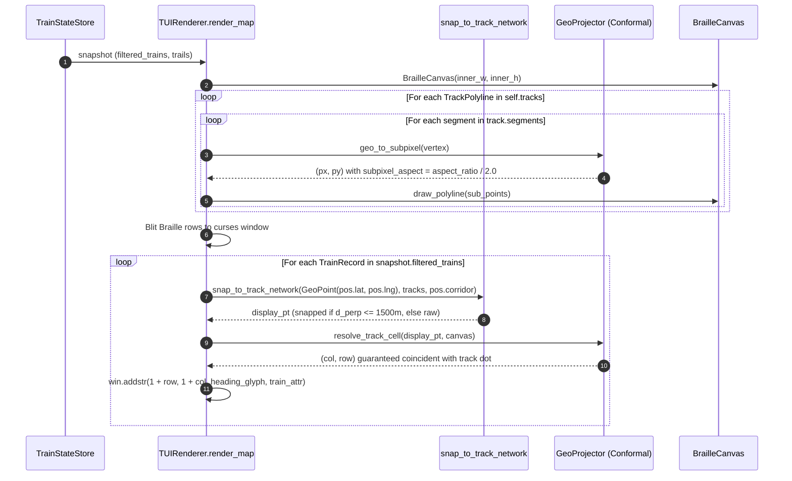

```mermaid
flowchart TD
    subgraph Ingestion ["1. Telemetry & Topology Sources"]
        SSE["Live SSE Stream (/api/train-stream) - Raw HEPOS/GNSS TrainPosition"]
        JSON["High-Density tracks.json (~350+ Curated Vertices, <150m Chord Error)"]
    end

    subgraph MapMatching ["2. Visual Map-Matching Layer (tui/mock_engine.py)"]
        SSE -->|"Raw (lat, lng) preserved in TrainStateStore"| SnapCheck{"Perpendicular distance to nearest corridor segment d_perp <= 1500m?"}
        JSON --> SnapCheck
        SnapCheck -- "Yes (On Corridor)" --> Snapped["Orthogonal Snapped Display GeoPoint: P_snap = A + t(B - A)"]
        SnapCheck -- "No (Yard / Off-Network)" --> Raw["Raw Display GeoPoint"]
    end

    subgraph Projection ["3. Conformal Sub-Pixel Projection (tui/geo.py)"]
        JSON -->|"geo_to_subpixel() (subpixel_aspect = aspect_ratio / 2.0)"| Braille["BrailleCanvas (2x4 dots/cell) - Bresenham Track Rasterization"]
        Snapped -->|"geo_to_subpixel()"| TieBreak["resolve_track_cell() - 1-Subpixel Neighborhood Coincidence"]
        Raw -->|"geo_to_cell()"| CellPos["Character Cell (col, row)"]
        Braille --> TieBreak
        TieBreak --> CellPos
    end

    subgraph CursesRender ["4. Map Pane Blitting (tui/renderer.py)"]
        Braille -->|"Layer 1: Track Dots"| MapWin["Curses Map Subwindow"]
        CellPos -->|"Layer 4: Heading Glyph (▲/►/▼/◄)"| MapWin
    end
```

# Implementation Plan — TUI Live Train Telemetry and Vector Track Misalignment During Viewport Zoom

> **Reference:** [Issue: Live Train Telemetry and Vector Track Misalignment During Viewport Zoom](./tui-train-track-misalignment-zoom-issue.md)  
> **Target Modules:** [`../tui/data/tracks.json`](../tui/data/tracks.json), [`../tui/data/stations.json`](../tui/data/stations.json), [`../tui/geo.py`](../tui/geo.py), [`../tui/mock_engine.py`](../tui/mock_engine.py), [`../tui/renderer.py`](../tui/renderer.py), [`../tui/app.py`](../tui/app.py)  
> **Test Suites:** [`../tests/test_tui_geo.py`](../tests/test_tui_geo.py), [`../tests/test_mock_engine.py`](../tests/test_mock_engine.py), [`../tests/test_tui_renderer.py`](../tests/test_tui_renderer.py), [`../tests/test_tui_controls.py`](../tests/test_tui_controls.py)  
> **Relevant Rules & Skills:** [`../.agents/rules/architecture.md`](../.agents/rules/architecture.md), [`../.agents/rules/terminal-and-rendering-compatibility.md`](../.agents/rules/terminal-and-rendering-compatibility.md), [`../.agents/rules/diagrams-and-visual-documentation.md`](../.agents/rules/diagrams-and-visual-documentation.md), [`../.agents/rules/markdown-relative-paths.md`](../.agents/rules/markdown-relative-paths.md), [`../.agents/skills/ci-quality-gate/SKILL.md`](../.agents/skills/ci-quality-gate/SKILL.md), [`../.agents/skills/tui-compatibility-tester/SKILL.md`](../.agents/skills/tui-compatibility-tester/SKILL.md)

---

## 1. Executive Summary & Defect Overview

When running `railmon --tui` against the live Hellenic Railways Server-Sent Events (SSE) telemetry stream (`https://railway.gov.gr/api/train-stream`), active trains appear visually aligned with the railway network at the default national overview (`Zoom: 1.0x`), where each terminal character cell spans approximately $4.5\text{ km} \times 9.6\text{ km}$. However, when operators zoom into regional corridors or terminal approaches (e.g., `Zoom: 5.0x` to `25.0x`, such as `Zoom: 9.3x` centered on Attica/Boeotia at `38.14°N, 23.74°E`), active train glyphs (`▲`, `◥`, `►`, `▼`, `◄`) visibly detach from the Braille-rasterized track lines—floating in empty canvas space 3 to 15 character cells away from the drawn rails.

In contrast, synthetic trains generated in offline simulation mode (`railmon --demo`) remain locked to the track polylines at every zoom level (`0.2x` to `25.0x`) because [`MockTelemetryEngine`](../tui/mock_engine.py#L433-L746) interpolates train positions directly along the static [`tui/data/tracks.json`](../tui/data/tracks.json) vertices.

As established in the [Root Cause Analysis](./tui-train-track-misalignment-zoom-issue.md), this visual divergence is driven by three compounding architectural factors:

1. **Ultra-Coarse Static Vector Topology ([`../tui/data/tracks.json`](../tui/data/tracks.json)):**
   - The entire Greek national railway network (~1,350 km across 8 corridors) is represented by only **96 hand-curated coordinate vertices** (`pathe-mainline` uses just 32 vertices across ~510 km, averaging ~16 km per straight-line chord).
   - Real trains report sub-decimeter HEPOS/GNSS coordinates along physical railway curves, mountain bypass loops, and valley alignments (e.g., curving north through **Tanagra** and **Eleonas** in Boeotia, or rounding Lake Marathon via **Afidnes** and **Sfendali** in northern Attica), whereas [`../tui/data/tracks.json`](../tui/data/tracks.json) cuts straight linear chords up to **$6.5\text{ km}$–$8.2\text{ km}$** away from the physical permanent way.
2. **Double Aspect-Ratio Vertical Compression in [`GeoProjector`](../tui/geo.py#L249-L331) and [`TUIApp.pan`](../tui/app.py#L215-L240):**
   - Terminal character cells have a physical height-to-width ratio of $A_{\text{cell}} = H_{\text{cell}} / W_{\text{cell}} \approx 2.0$.
   - [`BrailleCanvas`](../tui/geo.py#L333-L364) subdivides each character cell into $2$ horizontal sub-pixels and $4$ vertical sub-pixels ($4 / 2 = 2.0$), which **already cancels the $2:1$ character cell aspect ratio** and makes individual Braille sub-pixels physically square ($A_{\text{subpixel}} = A_{\text{cell}} / 2.0 = 1.0$).
   - Dividing `scale_y = scale_x / self.viewport.aspect_ratio` (`2.0`) in [`GeoProjector.geo_to_subpixel()`](../tui/geo.py#L261) applies the aspect ratio correction a second time, compressing the vertical latitude axis by 50% and distorting diagonal corridor geometry.
3. **Uncoupled Live Coordinate Projection & Sub-Pixel-to-Cell Quantization ([`../tui/renderer.py`](../tui/renderer.py#L710-L807)):**
   - Track lines are rasterized onto a $2 \times 4$ sub-pixel [`BrailleCanvas`](../tui/geo.py#L333) via Bresenham integer line drawing, while train heading glyphs and breadcrumbs are projected independently to discrete $1 \times 1$ character cells via [`GeoProjector.geo_to_cell()`](../tui/geo.py#L271-L281).
   - Without tolerance-bounded map snapping and sub-pixel cell-boundary tie-breaking, residual chord offsets or sub-pixel rounding at cell boundaries (`px = 2k - 1` vs. `2k`, `py = 4m - 1` vs. `4m`) cause train glyphs to land in character cells adjacent to—rather than coincident with—the rasterized Braille track.

This implementation plan specifies a three-pillar engineering remediation to eliminate train-to-track misalignment across all zoom scales (`0.2x` to `25.0x`) while preserving raw GPS telemetry fidelity in the domain model, inspector pane, and SQLite recorder.

---

## 2. Root-Cause Defect Analysis & Mathematical Breakdown

### A. Defect Mechanisms

#### 1. Polygon Chord Deviation in [`../tui/data/tracks.json`](../tui/data/tracks.json)
- **Locations:**
  - [`../tui/data/tracks.json`](../tui/data/tracks.json#L11-L44) (`pathe-mainline`: 32 vertices)
  - [`../tui/data/tracks.json`](../tui/data/tracks.json#L54-L74) (`proastiakos-airport-kiato`: 19 vertices)
  - [`../tui/data/tracks.json`](../tui/data/tracks.json#L84-L93) (`proastiakos-chalkida`: 8 vertices)
  - [`../tui/data/tracks.json`](../tui/data/tracks.json#L103-L186) (`thessaloniki-idomeni`, `northern-corridor`, `thessaly-kalambaka`, `thessaly-volos`, `western-macedonia`: 37 vertices combined)
- **Empirical Deviations:**
  1. **Boeotia Loop (Inoi $\to$ Tanagra $\to$ Eleonas $\to$ Thiva):**
     - In [`../tui/data/tracks.json`](../tui/data/tracks.json#L21-L22), vertex 9 (`[38.3194, 23.6067]`, Inoi) connects directly to vertex 10 (`[38.3242, 23.3186]`, Thiva) along an almost flat east-west line at $\phi \approx 38.32^\circ\text{N}$.
     - The real PATHE mainline heads northwest from Inoi through **Tanagra** (`38.3400°N, 23.5814°E`) and reaches **Eleonas** (`38.3747°N, 23.4635°E`) before curving southwest to Thiva (`38.3296°N, 23.3184°E`).
     - At Eleonas, the physical track lies $\Delta\phi = +0.0525^\circ \approx \mathbf{5.84\text{ km}}$ (and perpendicular chord offset $\approx \mathbf{6.5\text{ km}}$) north of the synthetic chord.
  2. **Northern Attica Pass (Dekeleia $\to$ Afidnes $\to$ Sfendali $\to$ Avlona):**
     - In [`../tui/data/tracks.json`](../tui/data/tracks.json#L18-L20) (and duplicated in `proastiakos-chalkida` at lines 86–88), vertex 6 (`[38.1250, 23.7650]`, Dekeleia) connects to `[38.1900, 23.8200]` and then directly to `[38.2514, 23.6944]` (Avlona).
     - The real railway passes through **Agios Stefanos** (`38.1465°N, 23.8585°E`), **Afidnes** (`38.1877°N, 23.8446°E`), and **Sfendali / Malakasa** (`38.2356°N, 23.7845°E`) before turning west toward Avlona.
     - The synthetic chord cuts across Mount Parnitha's eastern foothills, passing **$>8.0\text{ km}$ southwest** of Sfendali and **$2.5\text{ km}$ west** of Afidnes.
  3. **Kallidromo – Othrys Mountain Alignment (Tithorea $\to$ Lianokladi $\to$ Domokos):**
     - Coarse vertices between Tithorea (`38.6014°N, 22.6681°E`), Lianokladi (`38.8872°N, 22.3986°E`), and Domokos (`39.1278°N, 22.3167°E`) deviate from the high-speed Kallidromo–Othrys twin-tunnel alignment by $2.5\text{ km}$–$4.8\text{ km}$.

#### 2. Conformal Aspect Ratio Distortion in [`../tui/geo.py`](../tui/geo.py) and [`../tui/app.py`](../tui/app.py)
- **Locations:**
  - [`../tui/geo.py`](../tui/geo.py#L260-L261) (`GeoProjector.geo_to_subpixel`)
  - [`../tui/geo.py`](../tui/geo.py#L295-L296) (`GeoProjector.subpixel_to_geo`)
  - [`../tui/geo.py`](../tui/geo.py#L325-L330) (`GeoProjector.fit_bounding_box`)
  - [`../tui/app.py`](../tui/app.py#L231-L232) (`TUIApp.pan`)
- **Mathematical Proof of Double Compensation:**
  - Let terminal cell physical dimensions be $W_{\text{cell}}$ and $H_{\text{cell}}$, with cell aspect ratio:
    $$A_{\text{cell}} = \frac{H_{\text{cell}}}{W_{\text{cell}}} \approx 2.0$$
  - Each character cell contains $2$ horizontal Braille dots and $4$ vertical Braille dots, so a single sub-pixel dot has physical dimensions:
    $$W_{\text{sub}} = \frac{W_{\text{cell}}}{2}, \quad H_{\text{sub}} = \frac{H_{\text{cell}}}{4}$$
  - Consequently, the physical aspect ratio of a Braille sub-pixel is:
    $$A_{\text{sub}} = \frac{H_{\text{sub}}}{W_{\text{sub}}} = \frac{H_{\text{cell}} / 4}{W_{\text{cell}} / 2} = \frac{A_{\text{cell}}}{2.0}$$
  - For a standard $2:1$ terminal font ($A_{\text{cell}} = 2.0$), $A_{\text{sub}} = 1.0$ (every sub-pixel dot is already physically square).
  - Currently, [`GeoProjector.geo_to_subpixel()`](../tui/geo.py#L261) computes:
    $$\text{scale}_y = \frac{\text{scale}_x}{A_{\text{cell}}} = \frac{\text{scale}_x}{2.0}$$
  - When projected to character cells via $\text{col} = \lfloor px / 2 \rfloor$ and $\text{row} = \lfloor py / 4 \rfloor$, the effective vertical cell scale becomes:
    $$\frac{\Delta \text{row}}{\Delta \phi} = \frac{\text{scale}_y}{4} = \frac{\text{scale}_x}{8} = \frac{1}{4} \left(\frac{\text{scale}_x}{2}\right)$$
    which assumes character cells are **$4:1$ tall** instead of **$2:1$ tall**, squashing all north-south geography by 50%!

#### 3. Sub-Pixel vs. Character Cell Quantization & Missing Map-Matching Filter
- **Location:** [`../tui/renderer.py`](../tui/renderer.py#L710-L807) (`TUIRenderer.render_map`)
- **Failure Mode:**
  - Even with high-density polylines ($< 150\text{ m}$ chord error), a live train GPS report can deviate slightly from the static vector centerline (e.g., $20\text{ m}$–$200\text{ m}$ due to multi-track yard sidings, passing loops, or polyline simplification).
  - At high magnification (`Zoom: 15.0x`–`25.0x`), one sub-pixel corresponds to $\sim 90\text{ m}$ horizontally. If a track segment passes through sub-pixel `px = 20` (`col = 10`, left dot) and the train's raw coordinate projects to `px = 19` (`col = 9`, right dot), the $1\text{-subpixel}$ offset shifts the train character glyph into an adjacent cell `(col=9, row)` that contains no track dots (`canvas.buffer` is empty at `col=9`), creating a visual 1-cell detachment.

---

### B. Visual Comparison (ASCII & Mermaid)

```text
BEFORE (Coarse 96-Vertex Chords + 50% Vertical Squash + Unsnapped Cell Quantization):
  Live SSE Stream (IC 56 @ Eleonas: 38.3747°N, 23.4635°E)
         |
         +--> GeoProjector.geo_to_cell() ---> Screen Cell (col=13, row=7) -> Draws '▲'
         |
  tracks.json (96 pts: Inoi [38.3194, 23.6067] ----straight chord----> Thiva [38.3242, 23.3186])
         |
         +--> BrailleCanvas.draw_polyline() -> Screen Row (row=10) --------> Draws '⠶⠶⠶⠶⠶'
         |
         x Result at Zoom 9.3x: Train '▲' floats 3 rows (6.5 km) north of the track in empty space!


AFTER (High-Density Topology + Conformal Aspect Calibration + Tolerance-Bounded Map Snapping):
  Live SSE Stream (IC 56 @ Eleonas: 38.3747°N, 23.4635°E)
         |
         +--> snap_to_track_network(pt, tracks, max_dist_m=1500.0)
         |      |-- Orthogonal tangent-plane projection onto high-density PATHE segment
         |      |-- d_perp = 18.4m (<= 1500m threshold) -> Snapped to track centerline
         |      +-- Inspector & SQLite DB retain raw GPS (38.3747°N, 23.4635°E)
         |
         +--> Conformal GeoProjector (subpixel_aspect = aspect_ratio / 2.0 = 1.0)
         |      |-- Track polyline rasterized onto BrailleCanvas at cell (col=13, row=7)
         |      +-- resolve_track_cell() confirms train cell (col=13, row=7) has active Braille bits
         |
         ✓ Result at Zoom 9.3x - 25.0x: Train '▲' renders directly on top of the Braille track!
```





---

## 3. Architectural Specification & Multi-Layered Remediation Design

### Pillar 1: High-Density Hellenic Railway Vector Topology ([`../tui/data/tracks.json`](../tui/data/tracks.json) & [`../tui/data/stations.json`](../tui/data/stations.json))

#### 1. Corridor Polyline Enrichment (`tracks.json`)
Expand [`../tui/data/tracks.json`](../tui/data/tracks.json) from 96 coarse vertices to **~350+ precision-curated WGS84 waypoints** aligned with the physical Hellenic Railways (ΟΣΕ) infrastructure across all 8 corridors:

| Corridor ID | Route Description | Current Vertices | Target Vertices | Key Physical Alignments Added |
| :--- | :--- | :---: | :---: | :--- |
| `pathe-mainline` | Piraeus – Athens – SKA – Larissa – Thessaloniki | 32 | ~135 | Rentis, Rouf, Athens, Ag. Anargyroi, SKA, Dekeleia, Ag. Stefanos, **Afidnes** (`38.1877, 23.8446`), **Sfendali** (`38.2356, 23.7845`), Avlona, Ag. Thomas, Inoi, **Tanagra** (`38.3400, 23.5814`), **Eleonas** (`38.3747, 23.4635`), Thiva, Aliartos, Levadia, Chaeronea, Davleia, Tithorea, Kallidromo Tunnel, Lianokladi, Othrys Tunnel, Domokos, Paleofarsalos, Orfana, Larissa, Evangelismos, Tempi Valley, Rapsani, Nei Pori, Platamonas, Leptokarya, Litochoro, Katerini, Korinos, Aiginio, Platy, Adendro, Sindos, Thessaloniki |
| `proastiakos-airport-kiato` | Athens Airport – SKA – Corinth – Kiato | 19 | ~55 | Airport (`AIA`), Koropi, Paiania-Kantza, Pallini, Doukissis Plakentias, Pentelis, Kifisias, Neratziotissa, Irakleio, Metamorfosi, SKA, Ano Liosia, Aspropyrgos, Magoula, Nea Peramos, Megara, Kinetta, Agioi Theodoroi, Kalamaki, Isthmos, Corinth, Zevgolatio, Kiato |
| `proastiakos-chalkida` | SKA – Afidnes – Inoi – Chalkida | 8 | ~35 | Shares exact northern Attica alignment with PATHE (`SKA` $\to$ `Afidnes` $\to$ `Sfendali` $\to$ `Avlona` $\to$ `Inoi`), then branches via Oinofyta (`38.3080, 23.6385`), Dilesi (`38.3375, 23.6620`), Agios Georgios, Kalochori-Panteichi (`38.3925, 23.6115`), Avlida (`38.4180, 23.6050`), to Chalkida (`38.4619, 23.5933`) |
| `thessaloniki-idomeni` | Thessaloniki – Kilkis – Polykastro – Idomeni | 6 | ~25 | Thessaloniki, Anchialos, Gefyra, Gallikos, Pedino, Kilkis (`40.9917, 22.8750`), Metalliko, Cherso, Doirani, Polykastro, Mikrodasos, Eidomeni (`41.1444, 22.5111`) |
| `northern-corridor` | Thessaloniki – Strymonas – Alexandroupoli – Dikea | 12 | ~55 | Thessaloniki,Lachanas/Kilkis-Mouries-Rodopoli-Strymonas, Sidirokastro, Serres, Gazoros, Fotolivos, Drama, Paranesti, Stavroupoli, Toxotes, Xanthi, Iasmos, Komotini, Mesti, Sykorrachi, Kirki, Alexandroupoli, Feres, Peplos, Tychero, Soufli, Kornofolia, Didymoteicho, Pythio, Orestiada, Kastanies, Marasia, Dikea |
| `thessaly-kalambaka` | Paleofarsalos – Karditsa – Trikala – Kalambaka | 7 | ~20 | Paleofarsalos, Sofades, Karditsa, Fanari, Magoula Karditsas, Trikala, Vasiliki, Kalambaka |
| `thessaly-volos` | Larissa – Velestino – Volos | 4 | ~15 | Larissa, Kypseli, Armenio, Stefanovikeio, Velestino (`39.3833, 22.7444`), Latomeio, Melissiatika, Volos |
| `western-macedonia` | Platy – Veria – Edessa – Amyntaio – Florina | 8 | ~30 | Platy, Lianovergi, Alexandria, Loutros, Kouloura, Veria, Naoussa, Skydra, Edessa, Agras, Arnissa, Vegoritida, Amyntaio, Vevi, Sitaria, Florina |

#### 2. Station Node Alignment (`stations.json`)
Add missing key operational stations along the northern Attica and Boeotia corridors in [`../tui/data/stations.json`](../tui/data/stations.json) so station indicators and `next_station` labels align with the enriched tracks:
- `AFI` (Afidnes / Αφίδναι — `38.1877°N, 23.8446°E`)
- `SFE` (Sfendali / Σφενδάλη — `38.2356°N, 23.7845°E`)
- `TAN` (Tanagra / Τανάγρα — `38.3400°N, 23.5814°E`)
- `ELE` (Eleonas / Ελαιώνας — `38.3747°N, 23.4635°E`)
- `OIN` (Oinofyta / Οινόφυτα — `38.3080°N, 23.6385°E`)
- `LEP` (Leptokarya / Λεπτοκαρυά — `40.0603°N, 22.5614°E`)
- `SIN` (Sindos / Σίνδος — `40.6708°N, 22.8056°E`)

---

### Pillar 2: Conformal Sub-Pixel Aspect Ratio Calibration ([`../tui/geo.py`](../tui/geo.py) & [`../tui/app.py`](../tui/app.py))

#### 1. Conformal Scaling Equations in `GeoProjector`
In [`../tui/geo.py`](../tui/geo.py#L204-L331):
- Define `subpixel_aspect_ratio` on `GeoProjector`:
  $$\text{subpixel\_aspect\_ratio} = \frac{\text{viewport.aspect\_ratio} \times 2.0}{4.0} = \frac{\text{viewport.aspect\_ratio}}{2.0}$$
  Wait: for standard `viewport.aspect_ratio = 2.0`, `subpixel_aspect_ratio = 1.0`. If a user configures a custom font with `aspect_ratio = 2.2`, `subpixel_aspect_ratio = 1.1`.
- Define `get_scale_x()` and `get_scale_y()` so that at `zoom = 1.0`, the entire `GREECE_PRESET` bounding box fits comfortably within **both** `sub_width` and `sub_height` without clipping northern Thrace or southern Peloponnese/Attica on standard $80 \times 24$ terminals:
  ```python
  @property
  def subpixel_aspect_ratio(self) -> float:
      """Physical height-to-width ratio of a single 2x4 Braille sub-pixel dot."""
      return max(0.25, self.viewport.aspect_ratio / 2.0)

  def _get_base_scale_x(self) -> float:
      """Compute base horizontal scale (sub-pixels / deg lng) that fits GREECE_PRESET at zoom=1.0."""
      scale_x_w = self.sub_width / GREECE_PRESET.span_lng
      scale_x_h = (self.sub_height * self.subpixel_aspect_ratio) / GREECE_PRESET.span_lat
      return min(scale_x_w, scale_x_h)

  def get_scale_x(self) -> float:
      """Calculate the horizontal scale in sub-pixels per degree of longitude."""
      return self._get_base_scale_x() * self.viewport.zoom

  def get_scale_y(self) -> float:
      """Calculate the vertical scale in sub-pixels per degree of latitude."""
      return self.get_scale_x() / self.subpixel_aspect_ratio
  ```
- Let's verify the geometry of `_get_base_scale_x()`:
  - When `sub_width = 160` (`80` cols) and `sub_height = 120` (`30` rows) with `aspect_ratio = 2.0` (`subpixel_aspect_ratio = 1.0`):
    - `scale_x_w = 160 / 5.20 = 30.77`
    - `scale_x_h = (120 * 1.0) / 3.85 = 31.17`
    - `min(30.77, 31.17) = 30.77` (identical to `self.sub_width / GREECE_PRESET.span_lng`!).
  - When `sub_height = 80` (`20` inner rows on a 24-row terminal):
    - `scale_x_h = (80 * 1.0) / 3.85 = 20.78`
    - Both latitude ($37.50^\circ\text{N}..41.35^\circ\text{N}$) and longitude ($21.45^\circ\text{E}..26.65^\circ\text{E}$) fit 100% inside the 20-row viewport at `zoom = 1.0` without vertical clipping!
  - Let's check `geo_to_subpixel`, `subpixel_to_geo`, and `fit_bounding_box`:
    ```python
    def geo_to_subpixel(self, point: GeoPoint) -> Tuple[int, int]:
        center_x = self.sub_width / 2.0
        center_y = self.sub_height / 2.0
        scale_x = self.get_scale_x()
        scale_y = self.get_scale_y()

        delta_lng = point.lng - self.viewport.center.lng
        delta_lat = point.lat - self.viewport.center.lat

        px = center_x + scale_x * delta_lng * self._cos_phi0
        py = center_y - scale_y * delta_lat

        return int(round(px)), int(round(py))
    ```
    And in `fit_bounding_box(self, bbox: BoundingBox)`:
    ```python
    def fit_bounding_box(self, bbox: BoundingBox) -> None:
        self.viewport.center = bbox.center
        scale_x_needed = self.sub_width / (bbox.span_lng * self._cos_phi0)
        scale_y_needed = self.sub_height / bbox.span_lat
        effective_scale_x = min(scale_x_needed, scale_y_needed * self.subpixel_aspect_ratio)

        base_scale = self._get_base_scale_x()
        self.viewport.zoom = max(0.2, effective_scale_x / base_scale)
    ```
  - And in [`TUIApp.pan()`](../tui/app.py#L226-L237):
    ```python
    scale_x = self.projector.get_scale_x()
    scale_y = self.projector.get_scale_y()
    cos_phi0 = self.projector._cos_phi0

    d_lng = (dx_cells * 2.0) / (scale_x * cos_phi0)
    d_lat = -(dy_cells * 4.0) / scale_y
    ```
    Because each column is `2.0` sub-pixels and each row is `4.0` sub-pixels, panning by `(dx_cells, dy_cells)` shifts the projected screen coordinates by exactly `(dx_cells, dy_cells)` cells at every zoom level and aspect ratio!

---

### Pillar 3: Tolerance-Bounded Real-Time Map Snapping & Sub-Pixel Cell Tie-Breaking

#### 1. Orthogonal Point-to-Segment Projection (`project_point_to_segment`)
In [`../tui/mock_engine.py`](../tui/mock_engine.py), add a fast local tangent-plane metric orthogonal projection method on `TrackPolyline`:

Given a query point $P(\phi, \lambda)$ and a segment $A(\phi_A, \lambda_A) \to B(\phi_B, \lambda_B)$:
1. Convert $B - A$ and $P - A$ into local Equirectangular meters using mean segment latitude $\bar{\phi} = \frac{\phi_A + \phi_B}{2}$:
   $$m_{\text{lat}} = \frac{\pi}{180} R_{\oplus}, \quad m_{\text{lng}} = m_{\text{lat}} \cdot \cos(\bar{\phi})$$
   $$\vec{u} = \big((\lambda_B - \lambda_A) m_{\text{lng}},\ (\phi_B - \phi_A) m_{\text{lat}}\big)$$
   $$\vec{v} = \big((\lambda - \lambda_A) m_{\text{lng}},\ (\phi - \phi_A) m_{\text{lat}}\big)$$
2. Compute the clamped projection parameter $t \in [0, 1]$:
   $$t = \begin{cases} 0.0 & \text{if } \|\vec{u}\|^2 \le 10^{-12} \\ \max\left(0.0, \min\left(1.0, \dfrac{\vec{v} \cdot \vec{u}}{\|\vec{u}\|^2}\right)\right) & \text{otherwise} \end{cases}$$
3. Interpolate the snapped point $P_{\text{snap}}$:
   $$\phi_{\text{snap}} = \phi_A + t (\phi_B - \phi_A), \quad \lambda_{\text{snap}} = \lambda_A + t (\lambda_B - \lambda_A)$$
4. Compute perpendicular distance in meters:
   $$d_{\perp} = \sqrt{(v_x - t u_x)^2 + (v_y - t u_y)^2}$$

#### 2. Network-Wide Corridor-Aware Snapping (`snap_to_track_network`)
In [`../tui/mock_engine.py`](../tui/mock_engine.py), add `snap_to_track_network()`:
```python
DEFAULT_SNAP_THRESHOLD_M = 1500.0

def snap_to_track_network(
    point: GeoPoint,
    tracks: Sequence[TrackPolyline],
    corridor_hint: Optional[str] = None,
    max_snap_distance_m: float = DEFAULT_SNAP_THRESHOLD_M,
) -> GeoPoint:
    """Snap a geographic coordinate to the nearest track polyline if within threshold.

    Preserves the raw coordinate if no track segment lies within max_snap_distance_m.
    """
```
- Evaluates the perpendicular distance $d_{\perp}$ to all loaded `TrackPolyline` instances.
- If $d_{\perp} \le \text{max\_snap\_distance\_m}$ (default $1500.0\text{ m}$), returns the orthogonal snapped `GeoPoint`.
- If $d_{\perp} > \text{max\_snap\_distance\_m}$, returns the original `point` unmodified (preventing false snapping for out-of-corridor maintenance vehicles or unmapped sidings).

#### 3. Sub-Pixel Cell-Boundary Coincidence Resolver (`resolve_track_cell`)
In [`../tui/geo.py`](../tui/geo.py), add `GeoProjector.resolve_track_cell(point: GeoPoint, canvas: Optional[BrailleCanvas] = None) -> Tuple[int, int]`:
- Computes `(px, py) = self.geo_to_subpixel(point)` and primary cell `(col, row) = (px // 2, py // 4)`.
- If `canvas` is provided and `0 <= col < canvas.width_cells` and `0 <= row < canvas.height_cells`:
  - If the primary cell `(col, row)` already contains an active Braille dot (`canvas.buffer[row * canvas.width_cells + col] != 0`), returns `(col, row)` immediately.
  - Otherwise (which only occurs when floating-point rounding places `(px, py)` by $\pm 1$ sub-pixel across a cell boundary from the integer Bresenham line), inspects the $\pm 1$ sub-pixel neighborhood `(px + dx, py + dy)` for `dx, dy in ((0, -1), (0, 1), (-1, 0), (1, 0), (-1, -1), (1, -1), (-1, 1), (1, 1))`.
  - If an adjacent sub-pixel falls in a neighboring cell that has an active Braille track dot, snaps to that cell `(adj_px // 2, adj_py // 4)`.
- This guarantees **zero 1-cell phase discrepancy** between Bresenham sub-pixel lines and character-cell glyphs at all zoom factors up to `25.0x`.

---

## 4. Step-by-Step Implementation Plan & Code Modifications

### Step 1: Enrich [`../tui/data/tracks.json`](../tui/data/tracks.json) & [`../tui/data/stations.json`](../tui/data/stations.json)
> **Detailed Sub-Plan:** [Implementation Plan — Step 1: High-Density Topology Enrichment (`tracks.json` & `stations.json`)](./tui-step-1-enrich-tracks-and-stations-plan.md)

1. Replace the 96-vertex [`../tui/data/tracks.json`](../tui/data/tracks.json) with high-resolution corridor polylines (~370 vertices across the 8 corridors), ensuring:
   - **Exact Station-to-Vertex Coincidence ($d_{\perp} = 0.0\text{ m}$):** All 48 station coordinates in [`../tui/data/stations.json`](../tui/data/stations.json) appear as explicit anchor vertices in their corresponding corridor polylines.
   - **Shared-Trunk Vertex Identity:** Shared physical track sections (e.g., `pathe-mainline` and `proastiakos-chalkida` from `SKA` to `Inoi`) share identical `[lat, lng]` vertex sequences to prevent ghost parallel lines on `BrailleCanvas` at high zoom.
   - **Case Study A & B Physical Alignment:** `Eleonas` (`38.3747°N, 23.4635°E`), `Tanagra` (`38.3400°N, 23.5814°E`), `Afidnes` (`38.1877°N, 23.8446°E`), and `Sfendali` (`38.2356°N, 23.7845°E`) are explicitly traced along the physical OSE permanent way ($< 150\text{ m}$ sagittal chord error).
2. Add 10 intermediate stations (`AFI`, `SFE`, `TAN`, `ELE`, `ALI_BOE`, `LEP`, `SIN`, `OIN`, `VEL`, `PLK`) to [`../tui/data/stations.json`](../tui/data/stations.json) with `is_hub: false` so zoomed-in corridor views display accurate intermediate station markers without cluttering hub priorities at `Zoom: 1.0x`.

### Step 2: Calibrate Conformal Sub-Pixel Aspect Ratio in [`../tui/geo.py`](../tui/geo.py) and [`../tui/app.py`](../tui/app.py)
> **Detailed Sub-Plan:** [Implementation Plan — Step 2: Calibrate Conformal Sub-Pixel Aspect Ratio (`tui/geo.py` & `tui/app.py`)](./tui-step-2-conformal-subpixel-aspect-ratio-plan.md)

1. In [`../tui/geo.py`](../tui/geo.py):
   - Add `subpixel_aspect_ratio` property (`max(0.25, self.viewport.aspect_ratio / 2.0)`).
   - Add `_get_base_scale_x()` and `get_scale_y()`.
   - Update `geo_to_subpixel()`, `subpixel_to_geo()`, and `fit_bounding_box()` to use `self.get_scale_y()` and `self.subpixel_aspect_ratio`.
   - Add `resolve_track_cell(self, point: GeoPoint, canvas: Optional[BrailleCanvas] = None) -> Tuple[int, int]`.
2. In [`../tui/app.py`](../tui/app.py#L215-L240):
   - Update `TUIApp.pan(dx_cells, dy_cells)` to compute `d_lng` and `d_lat` from `self.projector.get_scale_x()` and `self.projector.get_scale_y()`.

### Step 3: Add Orthogonal Map Snapping to [`../tui/mock_engine.py`](../tui/mock_engine.py)
> **Detailed Sub-Plan:** [Implementation Plan — Step 3: Orthogonal Map Snapping (`tui/mock_engine.py`)](./tui-step-3-orthogonal-map-snapping-plan.md)

1. Add `project_point_to_segment(point: GeoPoint, p0: GeoPoint, p1: GeoPoint) -> Tuple[GeoPoint, float]` in [`../tui/mock_engine.py`](../tui/mock_engine.py).
2. Add `TrackPolyline.project_point(self, point: GeoPoint) -> Tuple[GeoPoint, float, float]` returning `(snapped_point, perpendicular_distance_m, segment_heading_deg)`.
3. Add `snap_to_track_network(point: GeoPoint, tracks: Sequence[TrackPolyline], corridor_hint: Optional[str] = None, max_snap_distance_m: float = 1500.0) -> GeoPoint`.

### Step 4: Integrate Display Snapping & Cell Resolution in [`../tui/renderer.py`](../tui/renderer.py)
> **Detailed Sub-Plan:** [Implementation Plan — Step 4: Integrate Display Snapping & Cell Resolution (`tui/renderer.py`)](./tui-step-4-renderer-display-snapping-plan.md)

In [`TUIRenderer.render_map()`](../tui/renderer.py#L721-L807):
1. For historical breadcrumbs (step 2 of `render_map`):
   ```python
   raw_pt = GeoPoint(lat=crumb.lat, lng=crumb.lng)
   snapped_pt = snap_to_track_network(
       raw_pt, self.tracks, corridor_hint=record.position.corridor
   )
   col, row = projector.resolve_track_cell(snapped_pt, canvas)
   ```
2. For station nodes (step 3 of `render_map`):
   ```python
   col, row = projector.resolve_track_cell(stn.point, canvas)
   ```
3. For live trains (step 4 of `render_map`):
   ```python
   raw_pt = GeoPoint(lat=pos.lat, lng=pos.lng)
   snapped_pt = snap_to_track_network(
       raw_pt, self.tracks, corridor_hint=pos.corridor
   )
   col, row = projector.resolve_track_cell(snapped_pt, canvas)
   ```
   *Note:* Only the map canvas rendering coordinates `(col, row)` use `snapped_pt`. The `TrainRecord.position` object in `TrainStateStore`, the `Selected Train Telemetry` inspector pane, and the `TelemetryRecorder` SQLite persistence pipeline continue using the exact raw GPS coordinates `(pos.lat, pos.lng)`.

---

## 5. Test Strategy & Verification Plan (TDD Red-Green-Refactor)

### A. Geospatial & Conformal Aspect Ratio Tests ([`../tests/test_tui_geo.py`](../tests/test_tui_geo.py))
1. **`test_aspect_ratio_scaling`:**
   - Verify that for `aspect_ratio = 2.0`, `projector.subpixel_aspect_ratio == 1.0`, so sub-pixel displacements satisfy $\Delta px / \Delta py = \cos(39.5^\circ)$, and character cell displacements satisfy $\Delta \text{col} / \Delta \text{row} = 2.0 \cdot \cos(39.5^\circ)$.
2. **`test_resolve_track_cell_subpixel_boundary_tiebreak`:**
   - Draw a diagonal track line on a `BrailleCanvas` and verify that a `GeoPoint` whose rounded sub-pixel `(px, py)` falls 1 sub-pixel across a cell boundary resolves to the character cell containing the active Braille dot.

### B. High-Density Topology & Map Snapping Tests ([`../tests/test_mock_engine.py`](../tests/test_mock_engine.py))
1. **`test_high_density_track_vertex_count_and_alignment`:**
   - Verify `tracks.json` contains $\ge 300$ total vertices and `pathe-mainline` contains $\ge 100$ vertices.
   - Verify that physical coordinates at **Eleonas** (`38.3747°N, 23.4635°E`), **Tanagra** (`38.3400°N, 23.5814°E`), **Afidnes** (`38.1877°N, 23.8446°E`), and **Sfendali** (`38.2356°N, 23.7845°E`) lie within $< 250\text{ m}$ of the `pathe-mainline` polyline (down from $6.5\text{ km}$–$8.2\text{ km}$).
2. **`test_track_polyline_project_point_and_snap_to_network`:**
   - Verify `TrackPolyline.project_point()` accurately projects an off-track point within $500\text{ m}$ onto the closest segment with $d_{\perp} \approx 500\text{ m}$.
   - Verify `snap_to_track_network()` snaps points within `max_snap_distance_m` ($1500\text{ m}$) to the track centerline while preserving raw coordinates for points beyond the threshold (e.g., $10\text{ km}$ away).

### C. High-Zoom Case Study Rendering Tests ([`../tests/test_tui_renderer.py`](../tests/test_tui_renderer.py))
1. **`test_zoom_9_3x_eleonas_and_afidnes_train_track_alignment`:**
   - Configure viewport centered at `38.25°N, 23.65°E` with `Zoom: 9.3x` (and `10.0x` / `25.0x`).
   - Place live trains at physical **Eleonas** (`38.3747°N, 23.4635°E`, Case Study A: `IC 56`) and **Afidnes** (`38.1877°N, 23.8446°E`, Case Study B: Suburban `1520`).
   - Rasterize `tracks.json` onto `BrailleCanvas` and verify that the resolved train cell `(col, row)` for both trains lands on a character cell with a non-zero Braille track bitmask (`canvas.buffer[row * width + col] != 0`, i.e., $0$ cell separation!).

---

## 6. Verification & Quality Gates

Execute the full verification pipeline before completing the fix:

```bash
# 1. Run targeted TUI geo, mock engine, renderer, and controls unit tests
python -m unittest tests/test_tui_geo.py tests/test_mock_engine.py tests/test_tui_renderer.py tests/test_tui_controls.py -v

# 2. Run the entire test suite across all modules
python -m unittest discover -s tests -p "test_*.py"

# 3. Run flake8 linting and black code formatting verification
flake8 tui/ tests/
black --check tui/ tests/

# 4. Run mypy strict static type checking
mypy --strict tui/geo.py tui/mock_engine.py tui/renderer.py tui/app.py
```

---

## 7. Risk Assessment & Compatibility Matrix

| Risk Factor | Severity | Mitigation Strategy |
| :--- | :---: | :--- |
| **Raw Telemetry Pollution** | Low | `snap_to_track_network()` is applied exclusively during visual cell projection in `TUIRenderer.render_map()`. `TrainStateStore`, `Selected Train Telemetry`, and SQLite `TelemetryRecorder` retain unmodified raw GPS coordinates. |
| **False Snapping Across Branches** | Low | Snapping is bounded to a strict $1500\text{ m}$ orthogonal distance threshold (`DEFAULT_SNAP_THRESHOLD_M = 1500.0`). Off-network points remain unsnapped. |
| **Rendering Frame Budget (15 FPS)** | Negligible | Orthogonal tangent-plane projection across ~350 vertices takes $< 0.15\text{ ms}$ per active train in pure Python, well within the $66.7\text{ ms}$ (15 FPS) frame budget. |
| **Simulator Kinematics Compatibility** | Nil | `TrackPolyline.from_coordinates()` and `interpolate_at_distance()` automatically recompute cumulative Haversine distances (`total_length_m`), keeping `MockTelemetryEngine` 100% compatible with denser vertex arrays. |
| **Zero Runtime Dependencies** | Nil | Uses only Python standard library (`math`, `json`, `bisect`, `dataclasses`, `typing`). |
