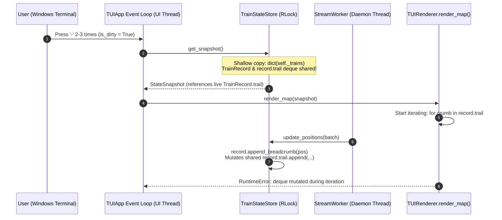
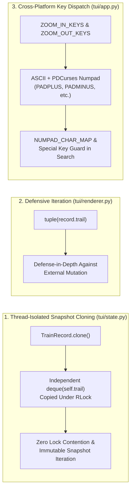

# Issue & Technical Resolution: Windows Terminal Zoom Controls (`+/-`) and Breadcrumb Trail Concurrency Crash (`RuntimeError: deque mutated during iteration`)

Comprehensive incident report, root cause analysis, concurrency diagnostics, PDCurses keycode mapping breakdown, and architectural resolution for the Windows Terminal zoom key malfunction and concurrent breadcrumb deque mutation exception in `railmon --tui`.

---

## 1. Issue Overview

### 1.1 Observed Symptoms
When running `railmon --tui` in **Windows Terminal** (PowerShell / Command Prompt backed by `windows-curses` / PDCurses):
1. **Unresponsive Numpad Zoom Controls (`+` / `-`)**: Pressing the `+` or `-` keys on the numeric keypad did not trigger viewport magnification or zoom-out in normal navigation mode.
2. **Fatal Crash on Rapid Zoom Input (`RuntimeError: deque mutated during iteration`)**: Pressing `-` 2 to 3 times while live telemetry was streaming caused the TUI to terminate with an unhandled `RuntimeError`:

```text
> .\railmon --tui
Traceback (most recent call last):
  File "railmon", line 11, in <module>
    sys.exit(main())
  File "train_tracker.py", line 1796, in main
    run_tui_mode(...)
  File "train_tracker.py", line 1192, in run_tui_mode
    run_tui(...)
  File "tui/app.py", line 635, in run_tui
    curses.wrapper(_curses_main)
  File "Lib/curses/__init__.py", line 94, in wrapper
    return func(stdscr, *args, **kwds)
  File "tui/app.py", line 632, in _curses_main
    app.run_loop()
  File "tui/app.py", line 525, in run_loop
    self.renderer.render_all(...)
  File "tui/renderer.py", line 1217, in render_all
    self.render_map(windows["map"], snapshot, projector)
  File "tui/renderer.py", line 725, in render_map
    for crumb in record.trail:
                 ^^^^^^^^^^^^
RuntimeError: deque mutated during iteration
```

```text
+---------------------------------------------------------------------------------------------------+
| Symptom Summary Matrix                                                                            |
+---------------------------------------------------------------------------------------------------+
| Subsystem         | User Action                   | Expected Behavior      | Actual Behavior      |
+-------------------+-------------------------------+------------------------+----------------------+
| TUI Input Handler | Press Numpad '+' or '-'       | Zoom in/out by 1.25x   | Ignored (Key 465/464)|
| Map Renderer      | Press '-' 2-3x during stream  | Smooth viewport redraw | Crash: RuntimeError  |
| Search Input Mode | Press function/numpad keys    | Ignore or map to ASCII | Stray High-Unicode   |
+---------------------------------------------------------------------------------------------------+
```

---

## 2. Architectural Root Cause Analysis

Two independent defects interacted to produce the user-observed behavior on Windows Terminal:



### 2.1 Defect A: Shallow Snapshot Copy Sharing Mutable `collections.deque` Across Threads

In [`tui/state.py`](../tui/state.py), `TrainStateStore.get_snapshot()` was designed to produce an immutable point-in-time `StateSnapshot` so the Curses UI thread could render frames without holding `self._lock`.

However, `get_snapshot()` previously performed only a **shallow dictionary copy** of `self._trains`:

```python
# Previous defective implementation in tui/state.py
with self._lock:
    trains_copy = dict(self._trains)
    filtered = self._compute_filtered_list(trains_copy)
```

While `trains_copy` isolated the top-level dictionary mapping (`train_id -> TrainRecord`), the `TrainRecord` instances inside `trains_copy`—and crucially their mutable `record.trail` (`collections.deque(maxlen=15)`) attributes—remained direct references to the live objects mutated by `StreamWorker`:

```text
+-----------------------------------------------------------------------------------+
| Shallow Snapshot Memory Sharing Hazard (Before Fix)                               |
+-----------------------------------------------------------------------------------+
|                                                                                   |
|   [StreamWorker Thread]                           [TUIApp Render Thread]          |
|   update_positions()                              get_snapshot()                  |
|         |                                               |                         |
|         v                                               v                         |
|   self._trains["1597"] --------+               snapshot.trains["1597"]            |
|                                |                        |                         |
|                                v                        v                         |
|                         +-------------------------------------+                   |
|                         |     Shared TrainRecord Instance     |                   |
|                         |  trail: deque([crumb1, crumb2, ...])|                   |
|                         +-------------------------------------+                   |
|                            ^                               ^                      |
|                            |                               |                      |
|                  trail.append(new_crumb)        for crumb in record.trail:        |
|                  (Mutates internal state)       (Raises RuntimeError!)            |
+-----------------------------------------------------------------------------------+
```

Why pressing `-` 2 to 3 times triggered the crash immediately:
- In [`tui/renderer.py`](../tui/renderer.py#L723-L735), iterating over `record.trail` performs orthogonal track-network snapping (`snap_to_track_network`) and sub-pixel cell resolution (`resolve_track_cell`) for every breadcrumb of every active train. This loop takes several milliseconds per frame.
- During idle operation, `TUIApp.run_loop()` skips rendering unchanged frames. When the user pressed `-` 2 to 3 times in rapid succession, `key != -1` set `is_dirty = True` on consecutive frames, forcing back-to-back executions of `render_map()` concurrently with incoming SSE batches from `StreamWorker`.
- As soon as `StreamWorker` called `record.append_breadcrumb(pos)` while `render_map()` was mid-iteration over `record.trail`, Python's `deque_iterator` detected the structural modification counter change and threw `RuntimeError: deque mutated during iteration`.

---

### 2.2 Defect B: Windows PDCurses Numpad Key Codes (`PADPLUS` / `PADMINUS`)

On Windows, Python's `curses` support is provided by `windows-curses`, which links against **PDCurses**. When `self.stdscr.keypad(True)` is enabled (required to capture arrow keys `KEY_UP`, `KEY_DOWN`, `KEY_LEFT`, `KEY_RIGHT`), PDCurses translates physical numpad keys into dedicated key constants rather than standard 7-bit ASCII codes:

| Physical Key | Standard ASCII (`ord`) | PDCurses Constant (`windows-curses`) | Integer Value |
|---|---|---|---|
| Top-row `+` / `=` | `ord('+') = 43`, `ord('=') = 61` | `43`, `61` | `43`, `61` |
| Top-row `-` / `_` | `ord('-') = 45`, `ord('_') = 95` | `45`, `95` | `45`, `95` |
| **Numpad `+`** | `43` (on ncurses/xterm) | `curses.PADPLUS` | **`465`** |
| **Numpad `-`** | `45` (on ncurses/xterm) | `curses.PADMINUS` | **`464`** |
| **Shift + Numpad `+` / `-`** | `43` / `45` | `curses.SHF_PADPLUS` / `SHF_PADMINUS` | **`533` / `534`** |
| **Ctrl + Numpad `+` / `-`** | `43` / `45` | `curses.CTL_PADPLUS` / `CTL_PADMINUS` | **`468` / `469`** |
| **Numpad `/`** | `47` | `curses.PADSLASH` | **`458`** |
| **Numpad `Enter`** | `10` / `13` | `curses.PADENTER` | **`459`** |

In [`tui/app.py`](../tui/app.py), `_handle_normal_input()` only checked:
```python
elif key in (ord("+"), ord("=")):
    self.zoom(1.25)
elif key in (ord("-"), ord("_")):
    self.zoom(1.0 / 1.25)
```
Consequently, pressing Numpad `+` (`465`) or Numpad `-` (`464`) on Windows Terminal fell through unhandled. Furthermore, in search mode (`_handle_search_input()`), any key `>= 32` was passed to `chr(key)`, meaning special curses key constants in the `256..548` range (such as `curses.PADMINUS = 464`) were misinterpreted as Unicode code points (`chr(464) == 'ǰ'`).

---

## 3. Architectural Resolution



### 3.1 Deep Cloning `TrainRecord` and `trail` Deque in `get_snapshot()`
In [`tui/state.py`](../tui/state.py#L60-L68), added `TrainRecord.clone()` and updated `TrainStateStore.get_snapshot()` ([`tui/state.py`](../tui/state.py#L324-L333)) so every snapshot receives its own independent `TrainRecord` and `deque` copy while holding `self._lock`:

```python
def clone(self) -> "TrainRecord":
    """Create a thread-isolated shallow copy with an independent trail deque."""
    return TrainRecord(
        position=self.position,
        trail=deque(self.trail, maxlen=self.trail.maxlen),
        first_seen=self.first_seen,
        last_updated=self.last_updated,
        update_count=self.update_count,
    )
```

Because `HistoricalBreadcrumb` and `TrainPosition` are immutable value objects and `max_trail_len` is bounded to 15 elements, cloning the deque under the lock is an $O(1)$ operation (microseconds) that guarantees complete thread isolation between `StreamWorker` and `TUIRenderer`.

### 3.2 Defense-in-Depth in `TUIRenderer.render_map()`
In [`tui/renderer.py`](../tui/renderer.py#L725), wrapped `record.trail` in `tuple(record.trail)` during breadcrumb rendering so that even if a caller constructs a synthetic `StateSnapshot` with a live `TrainRecord` in custom harnesses, iteration never occurs directly over a live `deque`.

### 3.3 Cross-Platform Zoom & Numpad Key Support in `TUIApp`
In [`tui/app.py`](../tui/app.py#L52-L106):
1. Defined platform-agnostic key tuples using `getattr(curses, ..., None)` so the code works seamlessly on both Linux/macOS (`ncurses`) and Windows (`windows-curses` / PDCurses):
   - `ZOOM_IN_KEYS`: `ord('+')`, `ord('=')`, `PADPLUS`, `SHF_PADPLUS`, `CTL_PADPLUS`
   - `ZOOM_OUT_KEYS`: `ord('-')`, `ord('_')`, `PADMINUS`, `SHF_PADMINUS`, `CTL_PADMINUS`
   - `SEARCH_OPEN_KEYS`: `ord('/')`, `PADSLASH`
   - `ENTER_KEYS`: `10`, `13`, `KEY_ENTER`, `PADENTER`
2. Added `NUMPAD_CHAR_MAP` and guarded `_handle_search_input()` ([`tui/app.py`](../tui/app.py#L480-L494)) against treating special curses key codes (`256 <= key <= KEY_MAX`) as printable Unicode characters.

---

## 4. Verification & Regression Testing

### 4.1 Automated Unit & Concurrency Tests
1. **Snapshot Deque Isolation ([`tests/test_tui_state.py`](../tests/test_tui_state.py#L341-L367))**:
   - `test_snapshot_thread_isolation`: Verifies that appending new breadcrumbs to `TrainStateStore` via `update_positions()` does not mutate `snapshot1.trains["ic-50"].trail` or `position` in a previously captured `StateSnapshot`.
2. **Multithreaded Deque Iteration Stress ([`tests/test_tui_state.py`](../tests/test_tui_state.py#L369-L425))**:
   - `test_concurrent_multithreaded_stress`: Spawns 4 concurrent writer threads continuously appending breadcrumbs at 1ms intervals alongside 2 reader threads iterating `for crumb in rec.trail:` across every train in `get_snapshot()`, verifying zero `RuntimeError` exceptions.
3. **Windows Numpad Zoom Key Dispatch ([`tests/test_tui_controls.py`](../tests/test_tui_controls.py#L232-L259))**:
   - `test_zoom_in_and_out`: Verifies `+`, `-`, `=`, `_`, `curses.PADPLUS`, and `curses.PADMINUS` scale `projector.viewport.zoom` accurately.

### 4.2 Test Suite Execution
```bash
python -m unittest tests/test_tui_state.py tests/test_tui_controls.py tests/test_tui_renderer.py tests/test_tui_integration.py -v
# Ran 83 tests in 3.378s - OK
```

---

## 5. Related Documentation
- [Phase 3: Thread-Safe State Store & SSE Worker](./phase-3-thread-safe-state-store-sse-worker.md)
- [Phase 4: Curses TUI Layout & Multi-Pane Rendering](./phase-4-curses-tui-layout-multi-pane-rendering.md)
- [Phase 5: Interactive Controls, Following & Filtering](./phase-5-interactive-controls-following-filtering.md)
